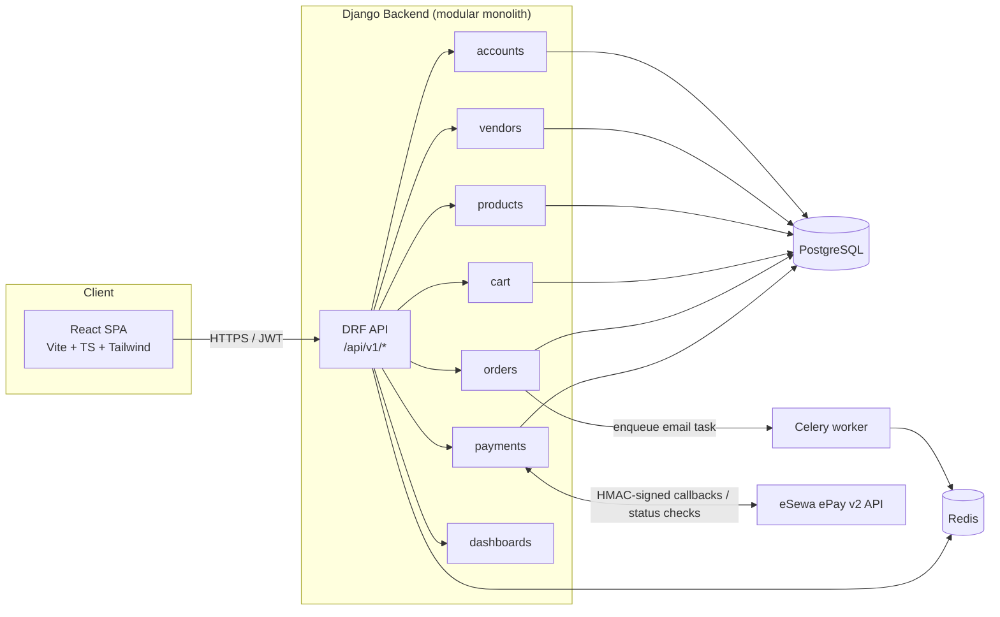
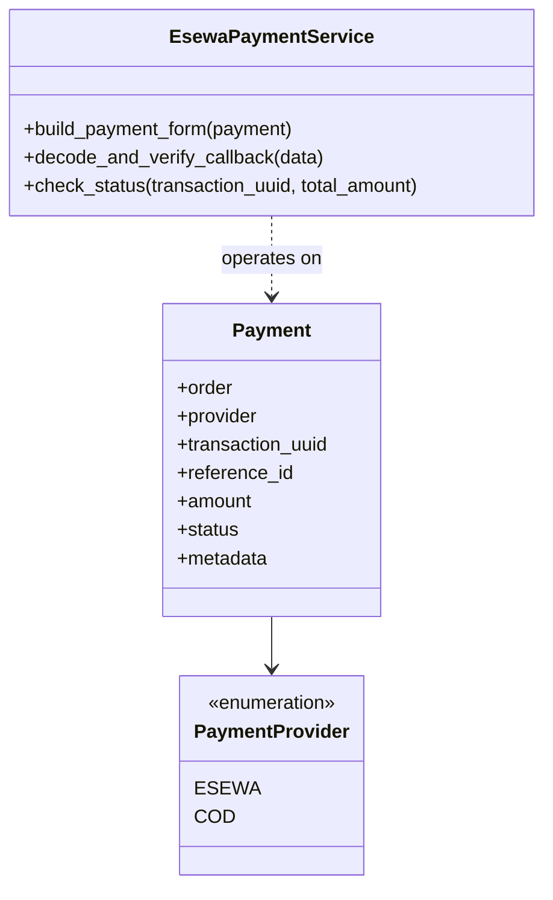
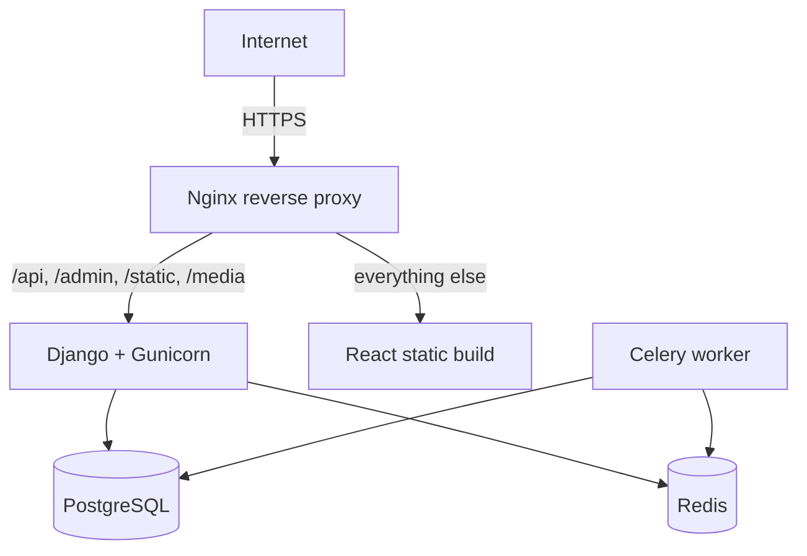

# Architecture

## 1. System overview

The application is a **modular monolith**: one Django project split into
focused apps (`accounts`, `vendors`, `categories`, `products`, `cart`,
`orders`, `payments`, `dashboards`), served behind a single DRF API, with a
separate React/TypeScript SPA consuming that API. This is intentional — a
capstone marketplace doesn't need microservices, and a modular monolith is
easier to reason about, test, and deploy while still keeping clean
boundaries that *could* later be extracted into services (see §7).



## 2. Frontend architecture

- **Vite + React + TypeScript**, strict mode, feature-based folders:
  `api/` (typed HTTP clients), `features/<domain>/hooks.ts` (TanStack Query
  wrappers), `pages/<public|customer|vendor|admin>/`, `components/{ui,layout}/`,
  `store/` (Zustand — auth + toasts), `routes/` (guards), `types/`.
- **Auth**: JWT access + refresh tokens held in a persisted Zustand store.
  An Axios response interceptor transparently refreshes an expired access
  token and retries the original request once; on refresh failure it logs
  the user out.
- **Data fetching**: TanStack Query owns all server state (products, cart,
  orders, dashboards) — no manual loading/error state juggling, automatic
  caching/invalidation on mutations.
- **Route guards**: `<ProtectedRoute allowedRoles={[...]}>` reads the
  Zustand auth store and redirects unauthenticated users to `/login` or
  unauthorized ones to `/`. This is a UX convenience only — see §5, the
  backend is the real authorization boundary.

## 3. Backend architecture

Each Django app owns one bounded concern:

| App          | Responsibility |
|--------------|-----------------|
| `common`     | Base models (UUID PK + timestamps), pagination, shared permissions, exception formatting |
| `accounts`   | Custom `User` model, JWT auth, registration, password reset, profile |
| `vendors`    | Vendor shop profile, approval lifecycle (`PENDING → APPROVED/REJECTED/SUSPENDED`) |
| `categories` | Category CRUD (admin-writable, publicly readable) |
| `products`   | Product + image CRUD, scoped separately for public/vendor/admin consumers |
| `cart`       | Per-customer cart and line items, stock-aware |
| `orders`     | Checkout orchestration, multi-vendor order splitting (§4), order history |
| `payments`   | Provider-agnostic `Payment` model + isolated eSewa integration (§6) |
| `dashboards` | Read-only aggregation endpoints for the three dashboards |

Business logic that spans models lives in a **service layer**
(`apps/orders/services.py`, `apps/payments/services/esewa.py`), not in
views/serializers — views stay thin (parse → call service → serialize).

## 4. Multi-vendor order design

A customer's cart can hold products from several vendors. Checkout fans
that single cart out into one parent `Order` (the customer's view of "my
order") and one `VendorOrder` per vendor represented in the cart, each with
its own `OrderItem` rows:

```
Order (customer-facing, one per checkout)
 ├─ VendorOrder  (vendor A's slice — vendor A manages only this)
 │   └─ OrderItem, OrderItem, ...
 └─ VendorOrder  (vendor B's slice — vendor B manages only this)
     └─ OrderItem, ...
```

- The customer sees the whole `Order` (all vendor slices, one payment,
  one shipping address) via `/api/v1/orders/`.
- Each vendor only ever sees their own `VendorOrder` rows via
  `/api/v1/vendor/orders/` — the queryset is filtered to
  `VendorOrder.objects.filter(vendor=request.user.vendor_profile)`, so a
  vendor cannot even discover another vendor's order ID (a request for it
  404s rather than 403s, avoiding existence leaks).
- Each vendor updates their own fulfilment status
  (`PENDING → CONFIRMED → PROCESSING → SHIPPED → DELIVERED`, or
  `CANCELLED`) independently; `Order.overall_status` derives a
  customer-facing summary across all vendor slices.
- `OrderItem` stores a **historical snapshot** (`product_name`,
  `product_sku`, `vendor_name`, `unit_price`, `line_subtotal`) captured at
  checkout time — it never re-reads the live `Product` row, so a later
  price change, rename, or deletion cannot alter a past order's records.

## 5. Authentication & authorization flow

1. `POST /api/v1/auth/login/` → SimpleJWT issues an access token (30 min)
   and refresh token (7 days, rotated + blacklisted on use).
2. Every subsequent request carries `Authorization: Bearer <access>`.
3. **Every** endpoint enforces role/ownership checks server-side —
   `IsAdminRole`, `IsVendorRole`, `IsCustomerRole` (in
   `apps/common/permissions.py`) plus queryset-level ownership filtering
   (a vendor's `ViewSet.get_queryset()` always starts from
   `vendor=request.user.vendor_profile`). Frontend route guards are a UX
   nicety; they are never the security boundary.
4. Vendor product/order mutations additionally check `vendor.status ==
   APPROVED` before allowing writes.

## 6. Payment architecture



`Payment` is provider-agnostic by design — adding Stripe/Khalti/Fonepay
later means adding a new `services/<provider>.py` module with the same
three responsibilities (initiate, verify callback, confirm status) and a
new `PaymentProvider` choice; `orders/services.py` and the checkout view
never need to change.

**eSewa flow** (ePay v2, per eSewa's current developer documentation):

1. **Initiate** — `EsewaPaymentService.build_payment_form()` builds an
   HMAC-SHA256 signed form (`total_amount,transaction_uuid,product_code`)
   that the frontend auto-submits to eSewa's hosted checkout page.
2. **Callback** — eSewa redirects the browser back to our
   `/checkout/esewa/success` page with a base64-encoded, signed JSON
   payload. The frontend forwards it to
   `POST /api/v1/payments/esewa/callback/`.
3. **Verify, twice** — the backend (a) verifies the HMAC signature on the
   callback payload itself, then (b) independently calls eSewa's
   server-to-server status-check API and only trusts *that* response.
   This defends against a forged or replayed redirect — the redirect is
   never treated as proof of payment on its own.
4. **Duplicate protection** — if the `Payment` is already `PAID`, a repeat
   callback for the same `transaction_uuid` is a no-op (checked before the
   second status-check call is even made). Every callback and status-check
   response is also logged to `PaymentTransactionLog` for auditing.
5. **Failure handling** — if the status check doesn't report `COMPLETE`,
   the payment is marked `FAILED` and `release_stock_for_failed_order()`
   restores the stock that checkout had reserved.

**COD flow** is simpler: the order is created with `payment_status=PENDING`
and each `VendorOrder` is immediately set to `CONFIRMED` (no online payment
step); stock is reserved at checkout time the same way.

## 7. Checkout & concurrency safety

`apps/orders/services.py::create_order_from_cart` runs inside a single
`transaction.atomic()` block:

1. Lock every `Product` row involved with `select_for_update()`.
2. Re-validate visibility and stock **inside the lock** (never trust the
   cart's cached state).
3. Compute subtotal/total from the *locked* `Product.price` — the frontend
   never supplies a price or total.
4. Create `Order` → `VendorOrder`(s) → `OrderItem`(s), decrement stock,
   clear the cart — all inside the same transaction, so a failure at any
   step rolls back everything (no half-created orders, no phantom stock
   decrements).

This prevents overselling under concurrent checkouts and ensures the
backend is the sole source of truth for money.

## 8. What could be extracted into services later

If this grew beyond a modular monolith, the natural seams are already
in place:

- **`payments`** → its own service; it already only talks to `orders`
  through the `Payment.order` FK and a couple of pure functions.
- **`products`** (catalog + search) → could move behind a search index
  (Elasticsearch/OpenSearch) without touching `orders` or `cart`, since
  they only depend on `Product`'s public fields.
- **`dashboards`** → read-only aggregation queries are the easiest to
  peel off into a reporting service reading from a replica.

## 9. Deployment architecture



See the README's "Deployment" section for the concrete VPS/Docker/Nginx/
HTTPS setup.
